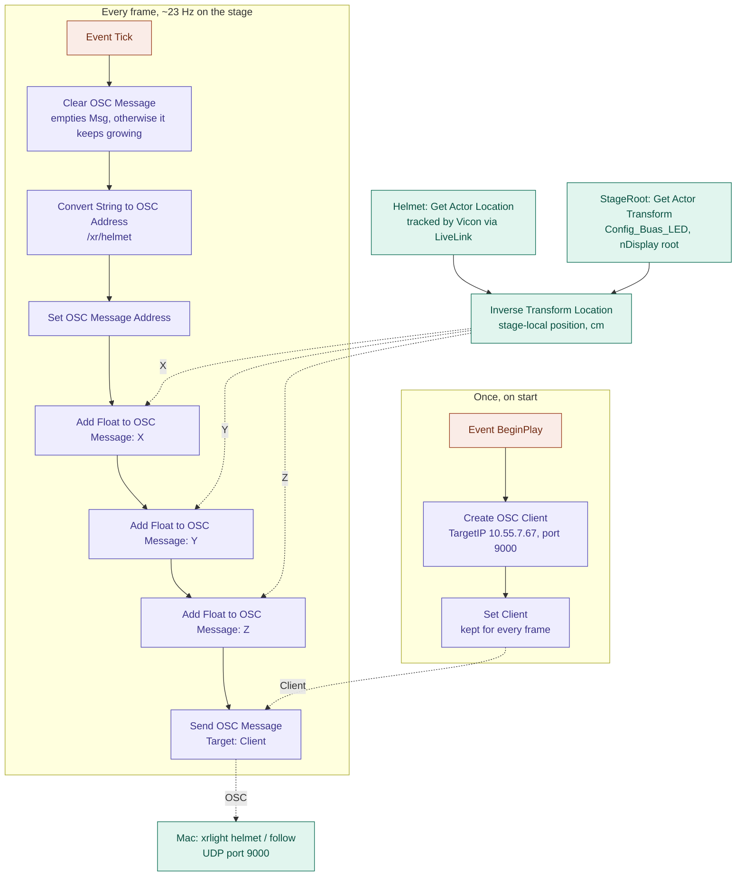

# XR Reactive Light

Project for reactive lighting on the XR Stage. It speaks Art-Net to the
stage's ENTTEC ODE Mk2 and the fixtures.

Patch and channel layouts come from the `Stage_DMX_Library` in
[VP-Template](https://github.com/BredaUniversityResearch/VP-Template) 

## Setup (macOS/linux)

Python 3.11+ 

```bash
cd xr-reactive-light
python3 -m venv .venv
source .venv/bin/activate
pip install -r requirements.txt
python -m pytest -q          
python -m xrlight check      # prints the patch, locked channels and notes
```

So far I am connection  via Ethernet cable. I guess you need to ask access to to it via ssh. 

## Commands
To test connection 
```bash
python -m xrlight monitor --port 6454  
```
First test command thats ignight all lisght in order in loop
```bash
python -m xrlight test --pattern identify --level 0.8
```
This is my dynimic lighting set up, firstly you indetify what monitor is The screen in my case that was 2. And than run the command with what ever on the stage screen as your extended screen.
```bash
.venv/bin/python -m xrlight screen --list-monitors
.venv/bin/python -m xrlight screen --monitor 2
```

Than Phil suggested for test connection with Unreal to do traking with moving head. 

So firstly I duplicated template 5.4, and did blueprint
 
The image not really reprecent blue print as there 3 errors but I didnt updated it. 





With TargetIP 10.55.7.67, port 9000 
then we run (with )

```bash
python tests/script_head.py
```
then we should recieve something like this
```bash
/xr/helmet [-114.5, 119.0, -62.2]
```

again 
```bash
.venv/bin/python -m xrlight helmet
```

then we need to colebrate each head 
```bash
   .venv/bin/python -m xrlight calibrate --head "Head left"
```
and
```bash
   .venv/bin/python -m xrlight calibrate --head "Head right"
```

To navigate use arrors and to exit use 's',
I did 15 points on left
And I did 6 on right
also I added flag `--others-off` because it is hard to tell without it.

generally I would advise to do 9 points and do it withit limit of the rig 

then testt it
```bash
   .venv/bin/python -m xrlight check
```

and finaly 
```bash
   .venv/bin/python -m xrlight follow --others-off
```

if you want to recolibrate delete  inside of config/calibration/

## Testing at home

You dont need the stage for most of it. Open two terminals, one shows what would go to the lights, the other sends a pattern:

```bash
python -m xrlight monitor --port 6455
python -m xrlight test --pattern palette --target 127.0.0.1:6455
```

To check the proxy and the safety part you need three. The `--raw` one pretends to be Unreal doing a 10 Hz strobe, and in the monitor you can see the proxy slowing it down:

```bash
python -m xrlight monitor --port 6455
python -m xrlight proxy --listen-port 6456 --target 127.0.0.1:6455
python -m xrlight test --pattern flash-test --raw --target 127.0.0.1:6456
```

The proxy prints how many frames it held back. If you stop the raw one, after 2 s it goes back to the home look by itself.

QLC+ also works (optional): in Inputs/Outputs give Universe 1 an Art-Net input, turn on Passthrough and open the DMX Monitor, then send with `--target 127.0.0.1`. But close QLC+ before running `proxy` or `monitor` on port 6454, only one program can listen there.

I also tried ESP32 with WLED: set its sync to Art-Net, universe 1, and send with `--target <esp-ip>`. Nice to see smoothing and delay with real light.

## On the stage

1. Plug the Mac in with the USB-C Ethernet (10.55.4.x network) and check you got an address between 10.55.4.1 and 10.55.7.254.
2. Run `python -m xrlight check` and then `test --pattern identify` on low level, and look that every light turns on in the right order. Make sure Unreal or QLC+ is **not** sending at the same time, two sources on one universe = flickering.
3. For the proxy you change Unreal's DMX output *Destination IP* from 10.55.4.7 to the Mac's IP and run `python -m xrlight proxy`. To undo just put 10.55.4.7 back.
4. For long sessions run it with `caffeinate -i python -m xrlight proxy` otherwise the Mac slows it down.
5. If nothing responds at all, the ODE Mk2 probably froze. Unplug it and plug it back (barrel plug, rack behind the screen), it is also on the DMX Troubleshooting page.

## Video mode on the stage

The lights take colour from what the Mac shows on the LED wall. Every fixture with a `[[zone]]` in `config/stage.toml` gets the average colour of its piece of the picture, the others just stay on home look.

1. How the signal goes (wiki page "Hooking up HDMI"): Mac → HDMI → capture card IN on the Recording PC → OBS (Blackmagic device, HDMI) → Fullscreen Projector on the HELIOS display. Send 1920x1080 from the Mac.
2. In QLC+ untick **Output** for the universe, otherwise it fights with xrlight.
3. Find which monitor is the wall and start:
   ```bash
   python -m xrlight screen --list-monitors
   python -m xrlight screen --monitor N
   ```
   You can also add `--gain` (0..2), `--fps` (how often it captures, 30 by default, DMX still goes at the config fps), `--target`, `--seconds`. Every second it prints the fps and how much the flash guard held back. Ctrl+C fades back to home look.
4. The wall is a bit behind the Mac (capture card, OBS, processor), so raise `--delay-ms` until lights and wall change at the same time.
5. macOS will ask for **Screen Recording** permission (System Settings → Privacy & Security → Screen Recording) for your terminal app. Turn it on and reopen the terminal, without it `screen` just stops.

Problem I know about: in real life the front lights would show what is *behind* the camera, and the wall does not show that. So mapping wall zones to lights is more like a first try, later it is better to take it from an Unreal SceneCapture.

## Safety

Every frame, for every light:

1. **Locked channels** (strobe, mode, unknown ones) always send their fixed value, nothing can change them.
2. **Range limits**: every channel maps 0..1 into its own `min`..`max`.
3. **Master level** is the max brightness (`safety.master`).
4. **Smoothing** with `smoothing_ms`, so no hard cuts.
5. **Flash guard**: max 3 flashes per second (`max_flashes_per_second`). One flash = going up and down by at least 10% (`flash_threshold`). If it is used up, brightness stays close to where it was.
6. **Fail-safe**: if the proxy gets nothing for `input_timeout_s` it fades to home look, and every command fades home when you close it.

Brightness is just `dimmer × strongest colour`, not really measured, so the flash limit is an approximation and not a certified thing. There is also a separate rule for red flashes in the guidelines which I did not do yet.

## Next steps

- Audio (`sounddevice` + FFT, beats with `aubio`).
- Take colours from Unreal SceneCapture instead of the wall.
- Orbiter in x/y 16-bit mode (need to ask permission) + its own profile.
- Measure real colour of each light and replace my guesses.
- For the report: ΔE between wall and light, latency, setup time vs doing it by hand.
