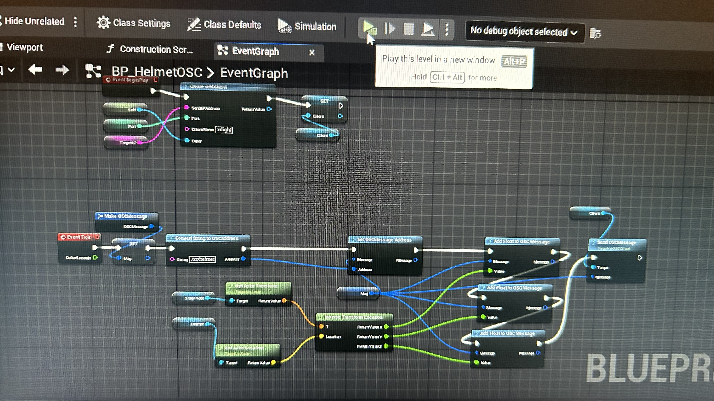
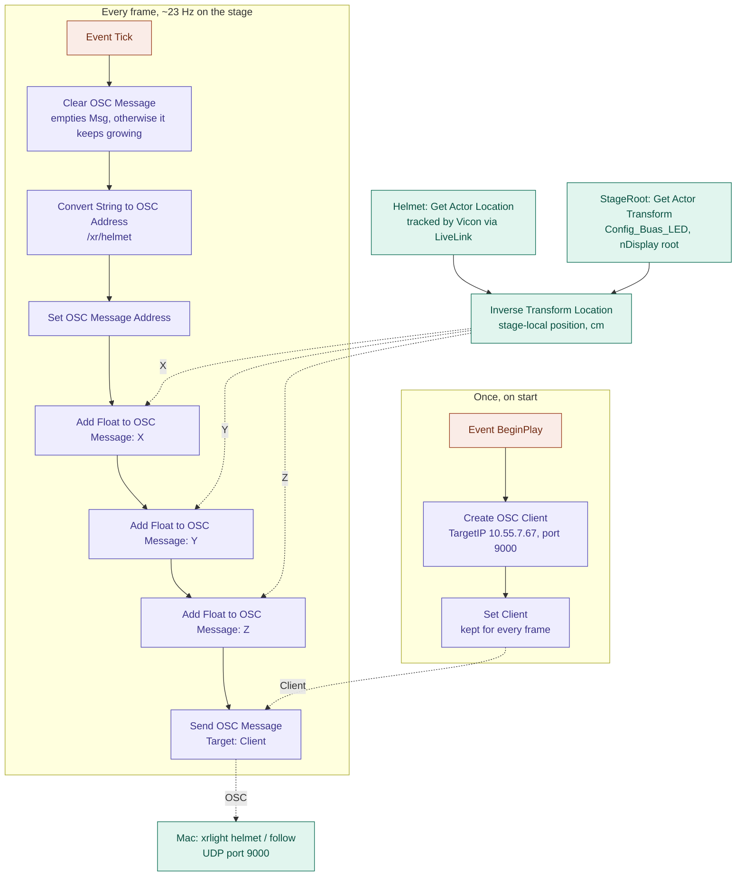
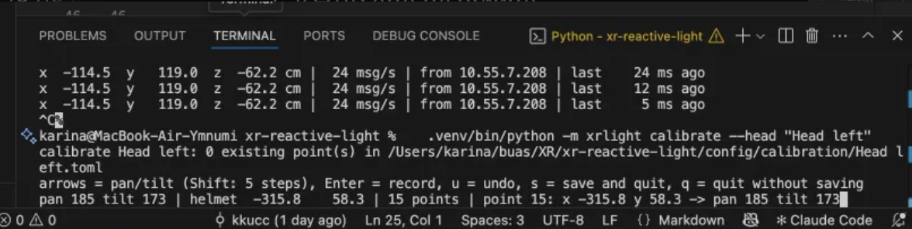

# XR Reactive Light

Project for reactive lighting on the XR Stage. It talks Art-Net to the stage's ENTTEC ODE Mk2 and the fixtures.

Patch and channel layouts are from the `Stage_DMX_Library` in
[VP-Template](https://github.com/BredaUniversityResearch/VP-Template)

## Setup (macOS/linux)

Python 3.11+

```bash
cd xr-reactive-light
python3 -m venv .venv
source .venv/bin/activate
pip install -r requirements.txt
python -m pytest -q
python -m xrlight check      # prints the patch, locked channels and notes
```

So far I am connecting via Ethernet cable. I guess you need to ask for access to it via ssh.

## Commands
To test the connection
```bash
python -m xrlight monitor --port 6454
```
First test command, it lights up all lights one by one in a loop
```bash
python -m xrlight test --pattern identify --level 0.8
```
This is my dynamic lighting set up. First you find which monitor is the stage screen, in my case it was 2. Then run the command with whatever is on the stage screen as your extended screen.
```bash
.venv/bin/python -m xrlight screen --list-monitors
.venv/bin/python -m xrlight screen --monitor 2
```

Then Phil suggested to test the connection with Unreal by doing tracking with the moving heads.

So first I duplicated template 5.4 and made a blueprint

The image doesnt really show the blueprint as it is now, there were 3 errors but I didnt update it.




With TargetIP 10.55.7.67, port 9000
then we run

```bash
python tests/script_head.py
```
and we should get something like this
```bash
/xr/helmet [-114.5, 119.0, -62.2]
```

then again with
```bash
.venv/bin/python -m xrlight helmet
```

then we need to calibrate each head
```bash
.venv/bin/python -m xrlight calibrate --head "Head left"
```
and
```bash
.venv/bin/python -m xrlight calibrate --head "Head right"
```

To move use the arrows and to save and exit press 's'.
I did 15 points on left
and 6 on right.
I also added the flag `--others-off` because it is hard to tell without it.

generally I would advise to do around 9 points and stay within the limits of the rig

then test it
```bash
.venv/bin/python -m xrlight check
```

and finally
```bash
.venv/bin/python -m xrlight follow --others-off
```

if you want to recalibrate delete the files inside config/calibration/

## Testing at home

You dont need the stage for most of it. Open two terminals, one shows what would go to the lights and the other sends a pattern
```bash
python -m xrlight monitor --port 6455
python -m xrlight test --pattern palette --target 127.0.0.1:6455
```

To check the proxy and safety you need three. The `--raw` one is like Unreal doing a 10 Hz strobe and in the monitor you see the proxy slowing it down
```bash
python -m xrlight monitor --port 6455
python -m xrlight proxy --listen-port 6456 --target 127.0.0.1:6455
python -m xrlight test --pattern flash-test --raw --target 127.0.0.1:6456
```
proxy prints how many frames it held back. if you stop the raw one after 2 s it goes back to home look by itself.

QLC+ also works (optional). In Inputs/Outputs give Universe 1 an Art-Net input, turn on Passthrough and open DMX Monitor, then send with `--target 127.0.0.1`. But close QLC+ before running `proxy` or `monitor` on port 6454, only one program can listen there.

I also tried ESP32 with WLED, set sync to Art-Net universe 1 and send with `--target <esp-ip>`. nice to see smoothing and delay with real light.

## On the stage

1. Plug in the Mac with USB-C Ethernet (10.55.4.x) and check you got an address between 10.55.4.1 and 10.55.7.254.
2. Run `python -m xrlight check` and then `test --pattern identify` on low level and look if every light turns on. Make sure Unreal or QLC+ is **not** sending at the same time, two sources on one universe = flickering.
3. For the proxy change Unreal's DMX output *Destination IP* from 10.55.4.7 to the Mac's IP and run `python -m xrlight proxy`. to undo put 10.55.4.7 back.
4. For long sessions use `caffeinate -i python -m xrlight proxy` otherwise the Mac slows it down.
5. If nothing responds at all the ODE Mk2 probably froze. Unplug it and plug back in (barrel plug, rack behind the screen), its also on the DMX Troubleshooting page.

## Video mode on the stage

Lights take colour from what the Mac shows on the LED wall. Every light with a `[[zone]]` in `config/stage.toml` gets the average colour of its part of the picture, the others stay on home look.

1. Signal goes like this (wiki page "Hooking up HDMI"): Mac → HDMI → capture card IN on the Recording PC → OBS (Blackmagic device, HDMI) → Fullscreen Projector on the HELIOS display. Send 1920x1080 from the Mac.
2. In QLC+ untick **Output** for the universe otherwise it fights with xrlight.
3. Find which monitor is the wall and start
   ```bash
   python -m xrlight screen --list-monitors
   python -m xrlight screen --monitor N
   ```
   you can also add `--gain` (0..2), `--fps` (capture, 30 default, DMX still goes at config fps), `--target`, `--seconds`. Every second it prints fps and how much the flash guard held back. Ctrl+C fades back home.
4. The wall is a bit behind the Mac (capture card, OBS, processor) so raise `--delay-ms` until lights and wall change together.
5. macOS asks for **Screen Recording** permission (System Settings → Privacy & Security → Screen Recording) for your terminal. Turn it on and reopen the terminal, without it `screen` just stops.

Problem I know about: in real life the front lights would show what is *behind* the camera and the wall doesnt show that. So wall zones to lights is more like a first try, later its better to take it from an Unreal SceneCapture.

## Safety

Every frame, for every light:

1. **Locked channels** (strobe, mode, unknown ones) always send their fixed value, nothing can change them.
2. **Range limits** every channel maps 0..1 into its own `min`..`max`.
3. **Master level** is max brightness (`safety.master`).
4. **Smoothing** with `smoothing_ms` so no hard cuts.
5. **Flash guard** max 3 flashes per second (`max_flashes_per_second`). One flash = up and down by at least 10% (`flash_threshold`). If its used up brightness stays close to where it was.
6. **Fail-safe** if the proxy gets nothing for `input_timeout_s` it fades to home look, and every command fades home when you close it.

Brightness is just `dimmer × strongest colour`, not measured, so the flash limit is an approximation not a certified thing. There is also a separate rule for red flashes which I didnt do yet.

## Next steps

- Audio (`sounddevice` + FFT, beats with `aubio`)
- colours from Unreal SceneCapture instead of the wall
- Orbiter in x/y 16-bit mode (need to ask permission) + own profile
- measure real colour of each light and replace my guesses
- for the report: ΔE between wall and light, latency, setup time vs by hand
